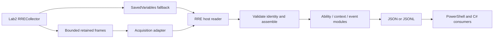

# SC-618 — Memory data bridge feasibility and one modular RRE host reader

**Decision: conditional GO for a small outbound prototype and one RRE-owned modular host reader. Not yet a qualified Lab2 live bridge.** The user clarified the goal: Lab2 addons publish back to physical-host consumers, potentially through one main multifunction reader. This study separates that host consumer from the location of the low-level acquisition component.

## What the tests actually proved

An existing, hash-pinned original RiftReader generic scanner read a controlled Python host-process buffer containing all54 current RRE ability records. It transferred three ASCII frames of7993/8167/492bytes, each within8KiB, in one bounded256KiB region scan. A second publication advanced sequence1→2 and transferred the same54 exact records. Joined record SHA256 agreed in both runs. Scanner process wall times were174.303ms and164.641ms. The fixture exited normally; no RIFT process, guest or addon was accessed by this experiment. These are two local fixture timings, not full-game scan, Lua, VMware transfer, sustained throughput or live-response benchmarks.

An independent offline audit accepted both full publications and rejected19 malformed/stale/assembly cases, including missing/duplicate/mixed parts, wrong session/sequence/producer, truncation, trailing data, wrong length/suffix, oversize, nonASCII wire, duplicate JSON keys and nonfinite values. The artifact parser is feasibility code, not a shipped consumer. Exact receipts/source hashes are in the [machine report](REA-RIFT-ADDON-MEMORY-BRIDGE-FEASIBILITY-2026-11-07.json).

The existing F4148B83 RR2 binary was also tested on the host with a distinct RREC1 marker. It returned exit2, Unsupported typed API marker, and created no output. Pinned source confirms this validation precedes target process open. Therefore the existing typed scanner cannot simply be configured for an RRE marker; this is an observed capability gap, not an assumption justifying a new backend.

## Existing code worth reusing, with its limits

| Existing component | Useful capability | Actual limit |
| --- | --- | --- |
| Original Reader generic `--scan-string` | Arbitrary ASCII prefix, optional explicit region, context bytes and JSON; actual binary passed the controlled proof | PID-only, no source/start/build/coverage/time qualification; locator and context reread are separate. Framework-dependent .NET10 build not proven installed/runnable in Lab2. |
| RR2 `snapshot-native` | Known-address, exact process/start/build-bound byte copy with explicit missing/partial state | Cannot locate an RRE marker; pointer may move between locator and reread. Existing installed B8 publication already used by RRE. |
| RR2 typed/casting readers | Bounded scanning, inline copies and strict source contracts provide sound patterns | Only RRAPIVAL2/RR2R1 or separate fixed RR2CASTREF1. Their exact producer/field schemas cannot carry an arbitrary RRE catalog. Do not borrow those markers or edit RR2. |
| Original `scripts/lua_memory` | Top-level `_G` discovery, primitive values, table addresses, one-level table-key iterator | Hard-coded probe anchors and unqualified Lua5.1 layout; no ready `.latest` path resolver, nested JSON projection, cycle/depth/node budgets or current-build acceptance. Tables are address/placeholders. |
| Current RRE SavedVariables route | Existing literal parser and accepted fresh54-ID transfers | Durable fallback, not live memory streaming; no reason to duplicate its Lua parser. |

Minimal generic locator shape, **not a live command executed on Lab2**:

```text
RiftReader.Reader.exe --pid <guest-RIFT-PID>
  --scan-string "RREC1|<fresh-load-or-request-token>|"
  --scan-encoding ascii --scan-context 8192 --max-hits 16 --json
```

Bound byte/time/range selection externally; do not run an unrestricted scan repeatedly. Exact nonce/token and expected publication sequence should be in the searchable prefix, once a real binding path exists. A source literal, old Lua string or maximum counter from another load is not a current frame. No existing no-addon-change nested-table extractor was found. A serialized producer is a smaller first step than qualifying a general Lua heap walker.

## One host reader, modules beneath it



Keep a single host entry point and a common observation/evidence envelope. A C# console/library core is a sensible initial implementation with the installed .NET10.0.302 SDK; consumers can use JSON/JSONL regardless of language. Start with capture/validate/diagnostics and the current catalog/context; add watch/event/diff capabilities only as needed. Acquisition is an adapter, not a second semantic reader per feature. Reuse original native tools or a qualified provider behind it; keep RR2/Workbridge source separate. SavedVariables ingestion should call the existing RRE literal parser, rather than introduce another Lua evaluator/parser.

A memory producer should retain immutable bounded strings, serialize only allowed scalar/array fields, publish one complete generation, preserve false/zero/unknown, and carry producer/schema/addon version, load identity, sequence, part/count, byte length, clocks, player/role/context and completeness. Fail closed on incomplete or mixed generations. Lua-generated identity is correlation, not authentication. Consumer-owned nonce delivery is not currently established by fixed mouse buttons. Old strings surviving GC, string relocation, truncated scans/match budgets and multiple recent publications are explicit test cases. Initial on-demand captures are more tractable than claiming continuous telemetry.

## Acquisition location and untested host-only alternative

Normal Windows ReadProcessMemory cannot reach a VM guest virtual address directly from the host. With existing tools, a read-only acquisition executable runs in the guest OS and returns data to the main physical-host reader. It remains external to the addon/game. Current mouse control stays host-side.

If every acquisition component must be host-only, [LeechCore documents direct live VMware Workstation access](https://github.com/ufrisk/LeechCore/wiki/Device_VMWare) with `vmware://ro=1,id=<Lab2-vmx-PID>`. It requires elevated Windows/SeDebugPrivilege,64-bit components, and excludes TPM/SecureBoot VMs. [MemProcFS process-memory APIs](https://github.com/ufrisk/MemProcFS/wiki/API_Python_Process) could then supply guest virtual reads. This is a documented alternative, not installed or tested here; it adds a privileged host dependency and still needs exact Lab2/process/paging/coherency qualification. The separate [nested VM parser](https://github.com/ufrisk/MemProcFS/wiki/VM) has different support rules. No host-only dependency was selected by default from the user's clarification.

## Remaining go/no-go gates

Proceed with the host reader's shared contract/adapters and an RRE-owned frame producer prototype. Before live acceptance, qualify source/package/install/loaded version, actual guest reader availability, exact VM/process/start/build/player/session, request completion, complete advancing frames and selected changed-state values. Bind locator and immediate reread; retain source bytes/hashes and reject stale/partial/torn/ambiguous scans. Measure the entire guest-to-host path. Then perform a load/restart stale-frame trial before durability claims. Keep SavedVariables available throughout.

No addon source/install, game memory, controller, other repo, dependency or provider was changed by this study. No game functions, injection or debugger were used. Two read-only built-in agents supplied scanner/table and host-only source investigations; manager independently retained17 source files and executed the existing-reader fixture tests. The first bridge direction is **addon→consumer**. Host→addon memory writes and arbitrary RPC are not part of this result.
